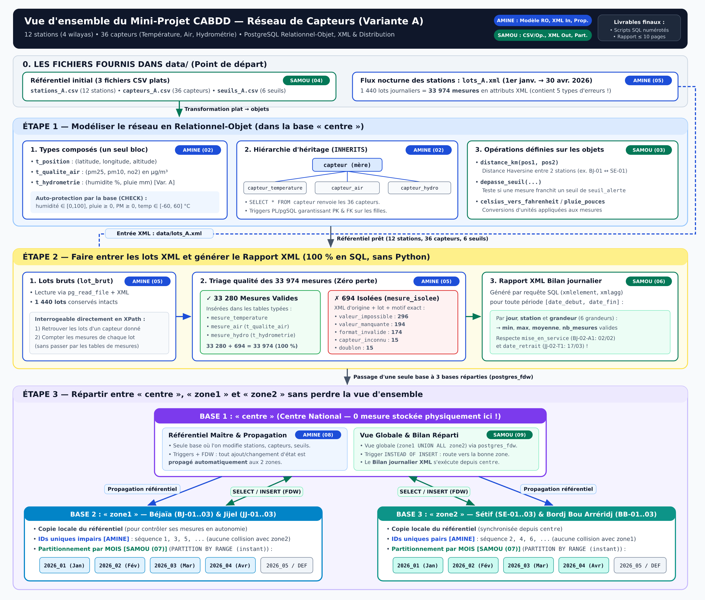

# Mini-Projet CABDD — Réseau de Capteurs Environnementaux (Variante A)

- **Module :** Concepts Avancés de Bases de Données (CABDD) — Dr S. Chabane - Mechiouri
- **Formation :** ING 4 Génie Logiciel (2026/2027) — Université de Béjaïa
- **Binôme :** **Merzouk Amine** & **Megharba Samou**
- **Variante retenue :** **Variante A**



> Guide visuel complet : [`docs/guide_visuel_projet.md`](docs/guide_visuel_projet.md)  
> Installation Windows 11 + PostgreSQL + VS Code & Bilan de `main` : [`docs/guide_installation_windows11.md`](docs/guide_installation_windows11.md)

---

## 1. Caractéristiques de notre Variante A

| Paramètre | Spécification Variante A |
| :--- | :--- |
| **Zone 1** | **Béjaïa**, **Jijel** (6 stations, 18 capteurs) |
| **Zone 2** | **Sétif**, **Bordj Bou Arréridj** (6 stations, 18 capteurs) |
| **Capteurs communs** | Température (`-T1`, en `°C`) & Qualité de l'air (`-A1`, `PM2.5`, `PM10`, `NO2` en `µg/m³`) |
| **Capteur spécifique** | **Hydrométrie (`-H1`)** : humidité relative (`%`) et pluie tombée depuis la mesure précédente (`mm`) |
| **Format XML entrant (`lots_A.xml`)** | Mesures **à plat**, valeurs en **attributs** (`<mesure capteur="..." instant="..." type="hydro" humidite="55" pluie="0.0"/>`) |
| **Organisation temporelle (Étape 3)** | Partitionnement **par mois** (`PARTITION BY RANGE` sur l'instant de mesure) |
| **Rapport XML sortant** | **Bilan journalier** : par jour, station et grandeur $\rightarrow$ `min`, `max`, `moyenne` et `nb_mesures` valides |

---

## 2. Répartition des Taches (50 % Merzouk Amine / 50 % Megharba Samou)

Afin d'avancer **en parallèle sans blocage** et de **maîtriser chacun les 3 étapes** pour le contrôle continu (50 %) et la soutenance (50 %), le travail est réparti par sous-systèmes complémentaires sur des scripts SQL séparés (zéro conflit Git) :

### Merzouk Amine — *Modèle Relationnel-Objet, Qualité/Ingestion XML & Propagation*
- **Étape 1 (`sql/02_schema_ro.sql`) :**
  - Définition des types composés (`t_position`, `t_qualite_air`, `t_hydrometrie`) et des énumérations métier.
  - Hiérarchie d'héritage des capteurs (`capteur` $\rightarrow$ `capteur_temperature`, `capteur_air`, `capteur_hydro`).
  - Contraintes `CHECK` d'intégrité physique (humidité $\in [0,100]$, pluie $\ge 0$, PM $\ge 0$, etc.) et **triggers PL/pgSQL** garantissant l'unicité de clé primaire et les clés étrangères sur toute la hiérarchie `INHERITS`.
- **Étape 2 (`sql/05_chargement_xml.sql`) :**
  - Chargement 100 % SQL de `data/lots_A.xml` et conservation intacte dans `lot_brut`.
  - Requêtes XPath directes sur les lots bruts (lots contenant un capteur donné, nombre de mesures par lot).
  - Pipeline de validation et d'isolement dans `mesure_isolee` selon les **5 motifs** (`valeur_impossible`, `valeur_manquante`, `format_invalide`, `capteur_inconnu`, `doublon`) avec preuve `valides + isolées = total XML`.
- **Étape 3 (`sql/07_zones_partitions.sql` [IDs] & `sql/08_propagation_referentiel.sql`) :**
  - Stratégie d'identifiants uniques à l'échelle du réseau (séquences impaires sur `zone1`, paires sur `zone2`).
  - Serveurs `postgres_fdw` et triggers de **propagation automatique du référentiel** de `centre` vers `zone1` et `zone2`.

---

### Megharba Samou — *Référentiel CSV & Méthodes Objet, Rapport XML & Distribution/Partitions*
- **Étape 1 (`sql/01_init_bases.sql`, `sql/03_operations_ro.sql`, `sql/04_referentiel_csv.sql`) :**
  - Création des 3 bases (`centre`, `zone1`, `zone2`) et chargement des 3 fichiers CSV (`stations_A.csv`, `capteurs_A.csv`, `seuils_A.csv`) vers les objets composés et sous-tables de capteurs.
  - Opérations en base sur les types composés :
    1. `distance_km(t_position, t_position)` (formule de Haversine entre deux stations) ;
    2. `depasse_seuil_*` (test de franchissement des seuils du référentiel) ;
    3. conversions d'unités adaptées à la Variante A (`°C` $\rightarrow$ `°F`, `mm` $\rightarrow$ `pouces`, point de rosée).
  - Jeux de tests prouvant le rejet des valeurs impossibles et des capteurs inexistants.
- **Étape 2 (`sql/06_rapport_xml.sql`) :**
  - Conception et justification de la structure XML du **Bilan journalier** (Variante A).
  - Fonction SQL/XML `generer_bilan_journalier_xml(p_date_debut, p_date_fin)` calculant `min`, `max`, `moyenne` et `nb_mesures` par jour, station et grandeur en tenant compte des dates de mise en service et de retrait.
- **Étape 3 (`sql/07_zones_partitions.sql` [partitions] & `sql/09_centre_transparent.sql`) :**
  - Partitionnement temporel **par mois** dans `zone1` et `zone2`.
  - Vues globales transparentes sur `centre`, routage automatique des insertions (`INSTEAD OF INSERT`) vers la bonne zone, exécution du rapport XML depuis `centre` et analyse des plans `EXPLAIN (ANALYZE, VERBOSE)`.

---

## 3. Ordre d'Exécution des Scripts SQL Livrables

Sur une instance PostgreSQL vierge (depuis la racine du dépôt, après dépôt des fichiers dans `data/`) :

| Ordre | Fichier | Responsable | Statut | Rôle |
| :---: | :--- | :--- | :---: | :--- |
| **01** | `sql/01_init_bases.sql` | Megharba Samou | ✅ Prêt | Création des bases `centre`, `zone1`, `zone2` et extensions |
| **02** | `sql/02_schema_ro.sql` | Merzouk Amine | ✅ Prêt | Types composés, hiérarchie `capteur*`, tables et triggers d'intégrité |
| **03** | `sql/03_operations_ro.sql` | Megharba Samou | ✅ Prêt | Fonctions sur objets (distance km, seuils, conversions Variante A) |
| **04** | `sql/04_referentiel_csv.sql` | Megharba Samou | ✅ Prêt | Transformation des 3 CSV plats vers le modèle RO + tests contraintes |
| **05** | `sql/05_chargement_xml.sql` | Merzouk Amine | ✅ Prêt | Lecture SQL de `lots_A.xml`, XPath sur lots bruts, tri valides / isolées |
| **06** | `sql/06_rapport_xml.sql` | Megharba Samou | ✅ Prêt | Requête/fonction SQL/XML du **Bilan journalier** paramétré |
| **07** | `sql/07_zones_partitions.sql` | Samou & Amine | ⏳ Samou | Schémas `zone1` & `zone2`, partitions mensuelles et séquences pair/impair |
| **08** | `sql/08_propagation_referentiel.sql` | Merzouk Amine | ✅ Prêt | Serveurs FDW et propagation automatique du référentiel `centre` $\rightarrow$ zones |
| **09** | `sql/09_centre_transparent.sql` | Megharba Samou | ⏳ Samou | Vues globales sur `centre`, routage `INSTEAD OF INSERT`, bilan XML réparti |
| **10** | `sql/10_tests_et_plans.sql` | Amine & Samou | ⏳ Ensemble | Batterie de validation complète, `EXPLAIN ANALYZE` et test panne d'une zone |

### Exécution rapide sous Windows 11 (PowerShell)
```powershell
.\run_all.ps1 -StopAt 4   # Tester l'Étape 1 (scripts 01 à 04)
.\run_all.ps1 -StopAt 6   # Tester les Étapes 1 et 2 (scripts 01 à 06)
.\run_all.ps1             # Tout rejouer de 01 à 10
```

---

## 4. Documentation de Coordination du Binôme

- [`docs/contrat_conception_variante_A.md`](docs/contrat_conception_variante_A.md) : Contrat technique figé entre Amine et Samou (noms exacts des types, colonnes, tables et signatures de fonctions).
- [`docs/plan_rapport_10_pages.md`](docs/plan_rapport_10_pages.md) : Répartition page par page du rapport final (10 pages max) et liste de toutes les questions théoriques/pratiques de l'énoncé.
- [`data/README.md`](data/README.md) : Emplacement des 4 fichiers de la Variante A (`stations_A.csv`, `capteurs_A.csv`, `seuils_A.csv`, `lots_A.xml`).
- [`rapport/rapport.md`](rapport/rapport.md) : Trame du rapport final avec les chiffres officiels vérifiés (`33 974 = 33 280 + 694`).

---

## 5. Checklist d'Avancement par Étape

- [x] **Démarrage** : Fichiers officiels `stations_A.csv`, `capteurs_A.csv`, `seuils_A.csv` et `lots_A.xml` déposés dans `data/`.
- [x] **Fin Étape 1** : `01` à `04` prêts à s'exécuter sans erreur (`.\run_all.ps1 -StopAt 4`) ; les 36 capteurs remontent via `SELECT * FROM capteur` ; les valeurs impossibles et capteurs inconnus sont rejetés ; les 3 opérations fonctionnent.
- [x] **Fin Étape 2** : `05` et `06` prêts à s'exécuter (`.\run_all.ps1 -StopAt 6`) ; `lots_A.xml` chargé en pur SQL (`33 280` valides + `694` isolées = `33 974`) ; lots bruts interrogeables en XPath ; Bilan journalier XML généré.
- [ ] **Fin Étape 3** : `08` (propagation & IDs d'Amine) est prêt ; il reste `07` et `09` (Samou) puis `10` (ensemble) pour finaliser la distribution et capturer les plans `EXPLAIN ANALYZE`.

---

## 6. 🔑 Mot de passe PostgreSQL oublié / mauvais identifiants (Windows)

Symptôme : `FATAL: password authentication failed for user "postgres"` lors de `.\run_all.ps1`.

### Réinitialiser le mot de passe (méthode pg_hba en `trust`)
1. Ouvrir `C:\Program Files\PostgreSQL\18\data\pg_hba.conf` (en admin, ex. Bloc-notes "Exécuter en tant qu'administrateur")
2. Remplacer `scram-sha-256` / `md5` par **`trust`** sur les lignes `local` et `host` :
   ```
   local   all   all                 trust
   host    all   all   127.0.0.1/32  trust
   host    all   all   ::1/128       trust
   ```
3. Redémarrer le service : `services.msc` → **postgresql-x64-18** → Redémarrer
   (ou PowerShell admin : `Restart-Service postgresql-x64-18`)
4. Ouvrir un terminal et définir un nouveau mot de passe :
   ```powershell
   psql -h 127.0.0.1 -U postgres -d postgres
   ALTER USER postgres PASSWORD 'postgres';
   ```
5. Remettre `scram-sha-256` dans `pg_hba.conf`, redémarrer le service → le mot de passe est de nouveau exigé.

### 🔧 Configurer SES identifiants une fois pour toutes (binôme)
Chaque membre du binôme définit **ses propres** identifiants dans un fichier **local et non commité** :
```powershell
# 1. Copier le modèle (une seule fois)
Copy-Item config.example.ps1 config.local.ps1
# 2. Éditer config.local.ps1 et mettre SON user / mot de passe :
#    $PGConfig = @{ HostName="127.0.0.1"; Port=5432; User="postgres"; Password="MON_MDP" }
# 3. Lancer : run_all.ps1 lit automatiquement config.local.ps1
.\run_all.ps1                 # lit config.local.ps1
# ou forcer en ligne de commande (prioritaire sur le fichier) :
.\run_all.ps1 -User postgres -Password 'ton_mot_de_passe'
```
> `config.local.ps1` est dans `.gitignore` : **aucun mot de passe n'est jamais poussé sur GitHub**. Samou met ses identifiants sur sa machine, Amine les siens sur la sienne.

### Lancer le projet avec TES identifiants
```powershell
$env:PGPASSWORD = 'ton_mot_de_passe'   # évite de l'écrire en clair
.\run_all.ps1
```
> Astuce : `psql -U postgres -d postgres` te connecte sans mot de passe si `pg_hba.conf` est en `trust` (pratique en local pour les tests).
