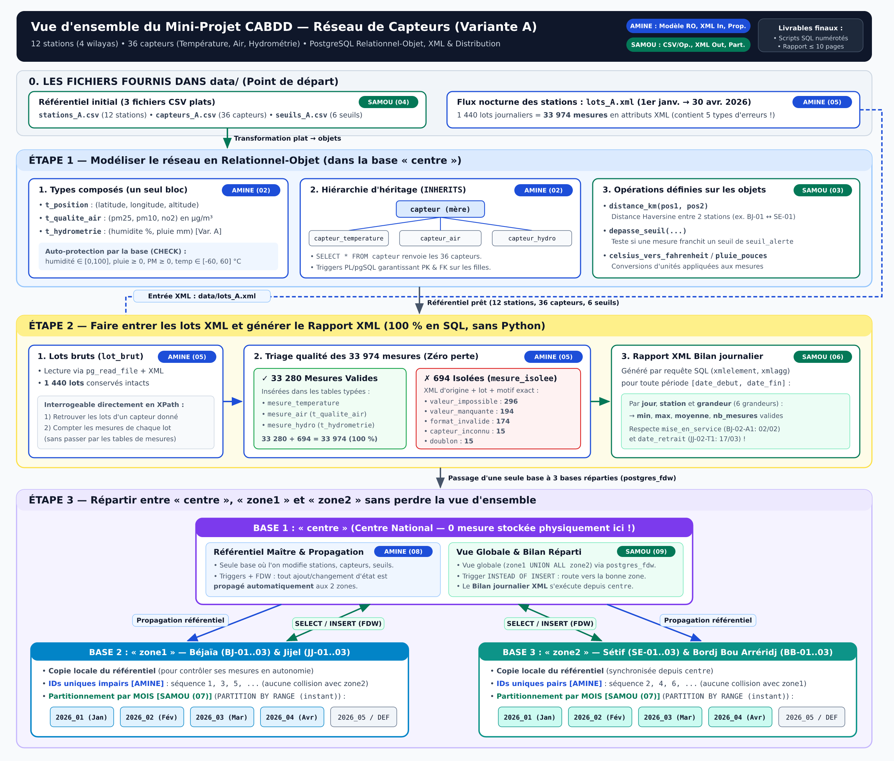

# Guide Visuel — Comprendre Tout le Projet en 3 Minutes (Variante A)

---

## L'idée générale (dans la vraie vie)

Imagine une agence nationale en Algérie qui surveille l'environnement dans **4 wilayas** regroupées en **2 zones** :
- **Zone 1 (Nord-Est côtier)** : **Béjaïa** (`BJ-01..03`) et **Jijel** (`JJ-01..03`) $\rightarrow$ 6 stations.
- **Zone 2 (Hauts-Plateaux)** : **Sétif** (`SE-01..03`) et **Bordj Bou Arréridj** (`BB-01..03`) $\rightarrow$ 6 stations.

Sur chacune des 12 stations, on a installé **3 capteurs** (donc **36 capteurs** au total) qui prennent une mesure **toutes les 3 heures** (`00h, 03h, 06h, ..., 21h`) :
1. `-T1` : **Température** (`°C`)
2. `-A1` : **Qualité de l'air** (`PM2.5`, `PM10`, `NO2` en `µg/m³`)
3. `-H1` : **Hydrométrie (spécifique Variante A)** (`humidité` en `%` + `pluie` en `mm`)

Chaque nuit, chaque station envoie sa journée de mesures dans un lot **XML** (`lots_A.xml`). Mais sur le terrain, les capteurs font parfois des erreurs (valeurs impossibles comme `-9999` ou humidité à `140%`, virgules au lieu de points, champs oubliés, doublons...).

---

## Le projet en 3 Étapes (de haut en bas sur le schéma)

### Étape 1 — Créer une base « intelligente » en Relationnel-Objet
Au lieu de tout mettre dans des colonnes simples comme en L2/L3 :
- **Amine (`02`)** regroupe ce qui va ensemble dans des **types composés** (`t_position`, `t_qualite_air`, `t_hydrometrie`) et crée une **famille de tables par héritage** (`capteur` $\rightarrow$ 3 sous-tables filles) protégée par des contraintes `CHECK` et des triggers.
- **Samou (`03`, `04`)** charge les 3 fichiers CSV (`stations_A.csv`, `capteurs_A.csv`, `seuils_A.csv`) dans ces objets et programme **3 fonctions SQL** sur ces objets (distance en km entre 2 stations, test de dépassement d'un seuil d'alerte, conversions d'unités).

### Étape 2 — Lire les lots XML sans rien perdre et produire un Bilan XML
Tout se fait **100 % en SQL** (interdiction d'utiliser Python pour nettoyer le fichier) :
- **Amine (`05`)** lit `lots_A.xml` (**1 440 lots = 33 974 mesures**), garde une copie brute dans `lot_brut` (interrogeable en XPath), et trie chaque mesure :
  - **33 280 mesures propres** vont dans les tables de mesures ;
  - **694 mesures erronées** vont dans `mesure_isolee` avec leur XML d'origine et la raison exacte (`valeur_impossible`, `valeur_manquante`, `format_invalide`, `capteur_inconnu`, `doublon`).
- **Samou (`06`)** écrit une requête SQL qui fabrique un document **XML « Bilan journalier »** donnant par jour, par station et par grandeur le `min`, le `max`, la `moyenne` et le `nombre de mesures`.

### Étape 3 — Séparer en 3 bases PostgreSQL tout en gardant une vue unique
Dans la réalité, chaque région garde ses mesures chez elle, et Alger (`centre`) consulte tout à distance grâce à **`postgres_fdw`** :
- **`zone1`** stocke uniquement les mesures de **Béjaïa & Jijel**, découpées **par mois** (`Jan`, `Fév`, `Mar`, `Avr`), avec des identifiants **impairs** (`1, 3, 5...`).
- **`zone2`** stocke uniquement les mesures de **Sétif & BBA**, découpées **par mois**, avec des identifiants **pairs** (`2, 4, 6...`).
- **`centre`** ne stocke **aucune mesure** physiquement, mais :
  - **Amine (`08`)** fait en sorte que toute modification du référentiel dans `centre` (nouvelle station, capteur hors service...) soit **copiée automatiquement** vers `zone1` et `zone2`.
  - **Samou (`07`, `09`)** crée les partitions mensuelles et une **vue globale** sur `centre` pour interroger ou insérer des mesures et générer le **Bilan XML** comme si tout était dans une seule base.
